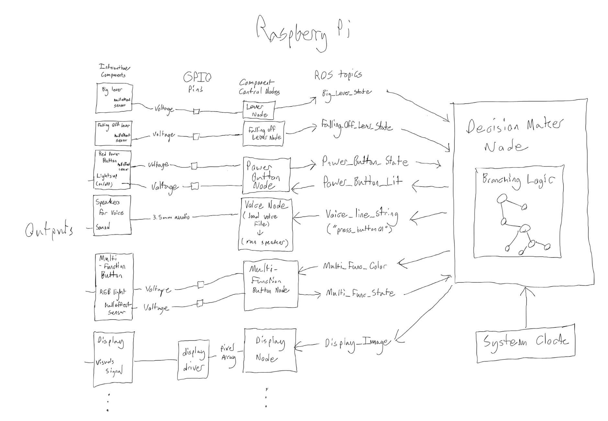

# Olin FUN Machine

An interactive prank machine: a Raspberry Pi runs the "brain" (ROS 2), and microcontrollers
(Teensy 4.1, Arduino) read the buttons, sliders and sensors and drive the motors and lights.
What the machine does, scene by scene, is in [docs/Script.md](docs/Script.md).



## Repository layout

```
Olin-FUN-Machine/
├── docs/                       Everything to read
│   ├── Script.md                 What the machine does, scene by scene (the spec)
│   ├── pi-teensy-protocol.md     Pi <-> Teensy serial protocol (single source of truth)
│   ├── Project Decisions.md      Team decisions (hardware, ROS, Docker)
│   ├── Software Plan.md          Software plan and schedule
│   ├── diagrams/                 Architecture and wiring diagrams
│   ├── setup/                    How to set up the development environment
│   ├── tutorials/                Tutorials on single concepts (protocols, loops, watchdogs, ...)
│   └── progress/                 Progress reports, one folder per date (Nov11, Nov16, ...)
│
├── firmware/                   Microcontroller code (Arduino IDE / arduino-cli)
│   ├── teensy/                   Teensy 4.1 main firmware (buttons, sliders, distance, LEDs, strip)
│   ├── teensy_test/              Teensy 4.1 hardware test program (type commands by hand)
│   └── dollar_eater/             Arduino Uno firmware for the Dollar Eater, with wiring guide
│
├── src/                        ROS 2 workspace (mounted into Docker at /ws/src)
│   ├── fun_interfaces/           Message and action definitions shared by all nodes
│   ├── fun_hardware/             Nodes that talk to hardware: teensy_node, dollar_eater_node, clip_player
│   ├── fun_core/                 The brain: scene runner, scenes/ (Intro, Sliders), decision_maker
│   └── fun_bringup/              Launch files that start the nodes together
│
└── docker/                     ROS 2 container for the Mac (sim) and the Pi (hw)
```

## Quick start (simulation on the Mac)

```bash
colima start
cd docker
docker compose --profile sim run --rm sim bash

# inside the container
cd /ws && colcon build && source install/setup.bash
ros2 launch fun_bringup scenes.launch.xml          # Intro and Sliders scenes
ros2 launch fun_bringup dollar_eater.launch.xml    # Dollar Eater
```

More detail: [latest progress report](docs/progress/Nov16/README.md),
[Dollar Eater guide](firmware/dollar_eater/README.md).

## Phases

1. Set up ros and project structure
2. Make node structures (interface or subclass?)
3. Make node simulated implementations
4. Make node hardware implementations
