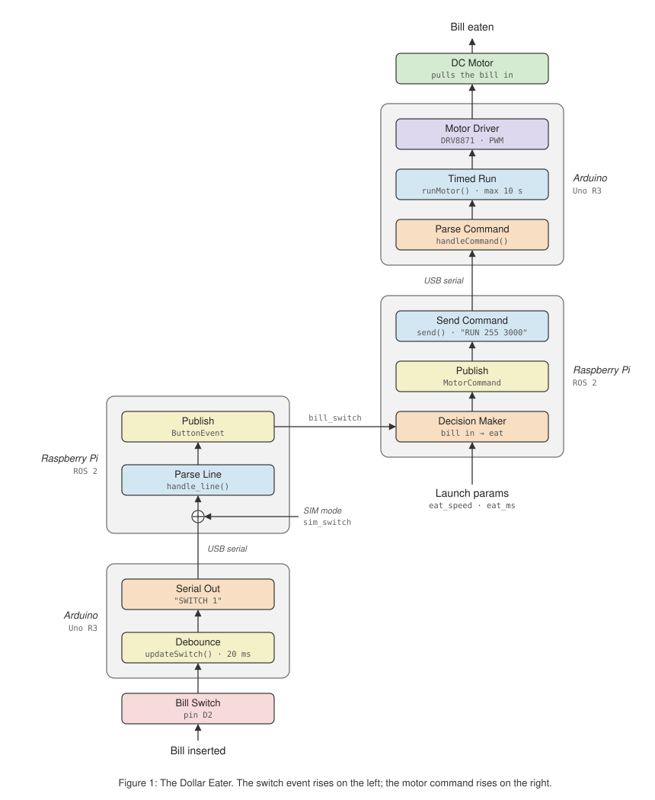

# Progress: Nov 11, 2026

## Done

- **`fun_interfaces` package:** shared message types (`ButtonEvent`, `MotorCommand`, `MatrixCommand`) and the `PlayClip` action.
- **Dollar Eater, end to end:** a bill presses the switch, and the Arduino reports it over USB serial. `dollar_eater_node` publishes a `ButtonEvent`, and `decision_maker` replies with a `MotorCommand`. The Arduino then drives the DRV8871, and the motor pulls the bill in for 3 s.
- **Safety:** every motor run is timed and capped at 10 s by the Arduino, even if the Pi stops responding.
- **Two modes:** simulation for testing on a Mac without hardware, and a `hw` Docker service for the Pi.

## Tested

- All four ROS packages build with no warnings.
- Simulation and a virtual serial port both pass.
- The firmware compiles for the Uno R3.
- **Not yet tested on real hardware.**

## Next

1. Wire and test the hardware (see `firmware/dollar_eater/WIRING.md`).
2. Build the brain's state machine and the `PlayClip` voice player.
3. Build the full Dollar Eater scene: voice lines, yes/no buttons, REJECTED.
