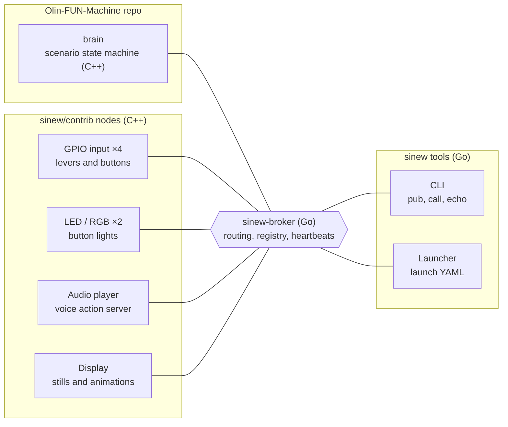

# Sinew + fun-machine: Project Plan

_Last updated: Nov 3, 2026_

*This document was created by Polaris(Murray), Claude to teach or break down work, plan, concept that the human makers of this project needed to understand.*

This is version 2 of the plan and replaces the earlier one. fun-machine's software is now written entirely in C++ and must be complete by **Dec 10, 2026**; the **Sinew** framework (working name) is built afterwards, through the end of February 2027, and fun-machine then migrates onto it. Team: Polaris (~30 h/week), Sam (~14 h/week), Derek (~4 h/week).

## Background

fun-machine is an interactive prank machine controlled by one Raspberry Pi 4 (8 GB): a big lever, a lever that falls off, a red power button, a multi-function button with an RGB light, speakers for voice lines, and a display. A decision maker (the "brain") reacts to what people do and drives the outputs.

**The original plan (Oct 30, in the repo).** The team's first decisions live in [`Project Decisions.md`](https://github.com/samjackson24816/Olin-FUN-Machine/blob/main/Docs%20and%20Learning/Project%20Decisions.md), the [README](https://github.com/samjackson24816/Olin-FUN-Machine/blob/main/README.md) and two tutorial documents, [Project Setup Guide](https://github.com/samjackson24816/Olin-FUN-Machine/blob/main/Docs%20and%20Learning/Tutorial%20Documents/Project%20Setup%20Guide.md) and [Setup Workflow](https://github.com/samjackson24816/Olin-FUN-Machine/blob/main/Docs%20and%20Learning/Tutorial%20Documents/Setup%20Workflow.md):

- **Hardware:** Raspberry Pi 4B with 8 GB of RAM.
- **Framework:** ROS 2 Lyrical in a Docker container on both the Macs and the Pi; both are arm64, so one image runs on both.
- **Workflow:** simulate on the Mac, test on the Pi. Every component node has a simulated backend and a hardware backend behind one abstract interface, and a launch argument picks which one runs.
- **Architecture:** one control node per component, ROS topics between them (`Big_Lever_State`, `Voice_line_string`, …), and a central Decision Maker with branching logic and a system clock.
- **Phases (README):** set up the project structure, define node structures, write simulated implementations, write hardware implementations.
- **Open questions it left:** Python or C++; which message types; which display hardware; whether the Pi hosts a web server for feedback and simulation; whether the Mac can see the Pi's topics.

**What we learned while planning**

- Most of the machine's hard problems are coordination problems: a voice line takes seconds, the brain must know when it ends, a person can interrupt it, and a part can crash. These are exactly the problems messaging frameworks like ROS solve.
- We studied ROS 2 and nano-Json-RPC (a small C++ JSON-RPC framework with publish/subscribe and service discovery) and decided to build our own small framework, Sinew, as a learning and portfolio project.
- The framework must be general purpose: it knows nothing about levers or buttons. fun-machine is its first user and lives in a separate repo.

**What we keep from the original plan, and what changes**

| Topic | Original plan (Oct 30) | This plan | Why |
| --- | --- | --- | --- |
| Hardware | Pi 4B, 8 GB | Same | — |
| Simulate on the Mac, test on the Pi | Yes | Kept | Three people can work without sharing one Pi |
| Sim + hardware backend per component | Abstract base class, two subclasses | Kept, in C++ | Same idea; the brain only ever sees the bus |
| Bring hardware up one piece at a time | Yes | Kept | — |
| Framework | ROS 2 Lyrical | Phase 1: our own small bus inside one program. Phase 2: Sinew | The learning goal is to build the messaging layer, not only use one; ROS 2 is heavy for one Pi |
| Language | Open question (Python suggested) | C++20 for the machine; Go for Sinew's broker and tools | Answers the open question; the C++ bus later becomes `libsinew` |
| Docker | ROS in a container on the Mac and the Pi | Dev container on the Mac and in CI; native binary under systemd on the Pi | Without ROS there is little to install, and native avoids passing GPIO, audio and display devices into a container. **Team to confirm** |
| Message types | `std_msgs` where possible | Small C++ structs on named topics, defined in `fun_bus` | No ROS message packages |
| Web server on the Pi | Open question | Deferred to phase 2 (Sinew's gateway) | Not needed for Dec 10 |
| Mac seeing the Pi's topics | Open question (DDS discovery problems) | Phase 2: Sinew CLI run on the Pi over SSH | Sinew uses local Unix sockets; SSH is enough |

An interim draft earlier this week planned the machine in Go; this document supersedes it.

**Key terms**

| Term | Meaning in this project |
| --- | --- |
| Node | One component with one job: a lever reader, the voice player, the brain. Phase 1: a thread. Phase 2: a process. |
| Topic | A named one-way channel. Publishers send messages to it; every subscriber receives them. |
| Service | A request that gets exactly one reply, always with a timeout. |
| Action | A long task with progress updates, a final result and the option to cancel, such as playing a voice line. |
| Bus | Whatever carries messages between nodes. Phase 1: an in-process bus (thread-safe queues). Phase 2: the Sinew broker over Unix sockets. |
| Broker | The central process every node connects to in phase 2; it routes messages and tracks who is alive. |
| Heartbeat | A small "I'm alive" message every second; three missed beats mean the node is treated as dead. |
| Contract tests | One test suite that checks the bus interface's behaviour, run against every implementation of it. |

## What Sinew is, and why we build it

Sinew is a messaging framework: a library plus a small broker process that lets the independent parts of a machine talk through named messages instead of calling each other directly. That decoupling is what makes each part replaceable, crash-isolated and testable on its own.

**What it gives an application**

- **Decoupling.** The lever node does not know the brain exists; it just publishes `lever.big.event`.
- **Asynchrony.** The brain starts a voice line, keeps handling other events, and is told when the line ends, fails or is cancelled.
- **Fault isolation.** In phase 2 every node is its own process, so a crashed display does not take down the levers.
- **Liveness.** Heartbeats tell the brain which parts are alive, so it can skip what is missing.
- **Tooling.** A command-line tool to watch and inject messages without touching hardware.

**Why not use an existing system**

| Option | Good at | Why not for us |
| --- | --- | --- |
| ROS 2 | A full robotics ecosystem | Heavy for one Pi; its discovery layer and build tooling are more than we need; we would learn to use a framework rather than build one |
| MQTT (Mosquitto) | Lightweight IoT publish/subscribe | No request/response, actions, cancellation or heartbeats built in |
| Kafka | Durable, high-throughput logs across clusters | Runs on the JVM with a large memory footprint; batching adds latency |
| Redis pub/sub | Simple and fast | Fire-and-forget, no replies or actions, and one more dependency |
| nano-Json-RPC | A clear C++ reference design | Its code has no heartbeats or timeouts; we borrow its layering and frame format |

Sinew's position: one board, low latency, four primitives, no external dependencies, clients in Go and C++. We will measure it against MQTT and ROS 2 on the same Pi rather than claim it is better.

## Goals and non-goals

Phase 1 succeeds when every scenario runs on the real machine by Dec 10; phase 2 succeeds when the same machine runs on Sinew with no change to its brain code, backed by measured numbers.

**Phase 1 goals: fun-machine (Nov 3 – Dec 10)**

1. All parts work on the Pi: big lever, falling-off lever, red power button, multi-function button, lights, voice, display.
2. The brain runs at least three scenarios written in YAML, including timeouts ("no press in 10 s → heckle") and a degraded path when a part is missing.
3. The machine is one C++20 program. Every part is a node on its own thread that talks only through the bus interface; nodes share no objects.
4. It runs 8 hours unattended without a crash, restarts via systemd if it does, and its AddressSanitizer and ThreadSanitizer builds are clean.

**Phase 2 goals: Sinew (Dec 11 – Feb 28)**

1. A general-purpose framework: Topic, Service, Action, and Registry with heartbeats, for any application on one Linux board. Nothing in it names fun-machine.
2. Go and C++ clients speak one documented wire protocol and pass the same golden test vectors. The C++ client, `libsinew`, grows out of fun-machine's bus code.
3. fun-machine migrates by swapping its bus implementation; its nodes become separate processes.
4. Latency, throughput and fault recovery are measured on the Pi and compared with MQTT and ROS 2.
5. CI on every push, sanitizer builds and Go race detector clean, fuzzed protocol parser, cross-language interop tests.

**Non-goals**

- No AI, LLM or agent features (a separate project covers these).
- No Go inside fun-machine: Go and C++ never share a process (no cgo).
- No multi-host clusters, load balancing or service replicas: one board, one broker.
- No Kafka or Redis. Docker is used for the Mac development container and CI; on the Pi the machine runs as a native binary under systemd.
- Not a ROS replacement: no navigation stack, parameter server or simulation tools.

## Plan at a glance

The machine never depends on the framework directly; it depends on a small C++ bus interface it owns. The fallback therefore exists from day one, and the later migration is a swap, not a rewrite.

| | Phase 1: fun-machine | Phase 2: Sinew |
| --- | --- | --- |
| Dates | Nov 3 – Dec 10, 2026 | Dec 11, 2026 – Feb 28, 2027 |
| Deliverable | Machine software complete | Sinew v0.1, with fun-machine running on it |
| fun-machine language | C++20 | C++20 (unchanged) |
| Framework work | Go: protocol spec and frame codec only, as a head start | Go: broker, Go client, tools. C++: `libsinew` |
| Bus under the machine | In-process: thread-safe queues | Sinew: Unix sockets + broker |
| Priority | The Dec 10 deadline beats everything | Quality, tests, measured numbers |

Language share: about 75–80% C++ by effort in phase 1; about 60% C++ and 40% Go across the whole project.

**The seam: a C++ bus interface owned by fun-machine**

- Five operations: `publish`, `subscribe`, `send_goal` (returns a handle with feedback and result), `cancel`, and timers (`after`, `every`).
- Implementation 1, written in week 1: in-process. Each node runs on its own `std::jthread`; messages travel through thread-safe queues and one dispatcher.
- Implementation 2, written in phase 2: an adapter onto `libsinew`.
- Discipline: nodes talk only through the bus. No shared objects, no raw `new`. This is what makes the later split into processes cheap.

**Fallback rule**

- The machine ships on the in-process bus. No Sinew code is a dependency of the machine before Dec 10.
- No change of bus implementation after Nov 23.
- If a checkpoint slips, cut scenarios, never hardware parts.

## How the two repos meet

In phase 1 the repos share a design, not code. In phase 2 code flows both ways and ends with one dependency direction: fun-machine depends on Sinew, never the reverse.

| Step | When | From → to | What moves |
| --- | --- | --- | --- |
| 1. Design | Nov | `fun_bus` → Sinew spec | Sinew's operations and message semantics mirror the bus interface exactly |
| 2. Extract | Dec | `fun_bus` → `sinew/cpp` | The in-process bus and action state machine become `libsinew`'s in-memory transport, already proven on the machine |
| 3. Adapt | Jan | `sinew` → `fun_bus` | fun-machine gains a `libsinew` adapter; brain and scenarios do not change |
| 4. Generalize | Feb | `fun_hardware` → `sinew/contrib` | Pins and topic names become config; fun-machine keeps only its config files |

**Contract tests**

- A GoogleTest suite in `fun_bus` checks the interface's behaviour, not any one implementation: a published message reaches every subscriber; a latched topic gives a new subscriber the last value; cancelling a running goal goes EXECUTING → CANCELING → CANCELED; timers fire on time; one slow subscriber does not block the others.
- Phase 1: the suite runs against the in-process bus. Phase 2: the same suite runs against the `libsinew` adapter. When it passes and the scenario tests pass on Sinew, migration is done.
- Polaris writes the suite together with the interface in week 1; Sam reviews it. It is the contract between the two repos.

## Architecture

**Phase 1** is one C++ process on the Pi. Each part (GPIO input, lights, audio, display, brain) is a node on its own thread, and nodes talk only through the in-process bus. systemd starts the program and restarts it if it exits.

**Phase 2 (target, below)** splits the same nodes into separate processes. Each holds one Unix-socket connection to the Sinew broker, which is written in Go.

Each line is one Unix-socket connection. The Sinew core libraries — the Go client (`go/sinew`), the C++ client (`libsinew`) and the protocol spec with its golden test vectors — are linked into every process.

After migration fun-machine contributes only the brain and its config; its hardware nodes have become configurable Sinew contrib nodes, still in C++.

## Framework design (Sinew, phase 2)

Sinew is a broker-centered star: every node holds one Unix-domain-socket connection to the broker, which routes all messages and tracks who is alive.

**Four primitives**

| Primitive | Semantics | Typical use |
| --- | --- | --- |
| Topic | Publish/subscribe; optional "latched" (new subscribers get the last value); per-subscriber queue depth | Sensor events, state, light commands |
| Service | Request/response with a mandatory timeout; blocking or asynchronous call | Queries such as "what is the current state?" |
| Action | Long-running goal with feedback, result and cancel; the 7-state goal machine from ROS 2 | Play a voice line, play an animation |
| Registry + heartbeat | Nodes register capabilities on connect and send a heartbeat every second; 3 missed beats = offline, broadcast to all | Degraded mode, plug-in components |

**Wire protocol**

- Length-prefixed frames, big-endian: `len | mtype | idlen | id | body`, with a JSON body (adapted from nano-Json-RPC's `LVProtocol`).
- The first message on every connection is a handshake: node name, language, protocol version, capabilities. A version mismatch is rejected.
- Message type numbers are frozen once released; new types are only appended.
- The `_sinew.*` namespace is reserved for system traffic (registry, heartbeats, online/offline events).
- The spec and a set of golden test vectors live in `spec/`; both client libraries must pass them.

**Extension points the application fills in**

- Node lifecycle hooks: configure, activate, deactivate, error (go to a safe state).
- An event loop: subscriptions, timers and action callbacks handled on one thread or goroutine.
- Action server policies: accept or reject a goal, preempt on a new goal, allow cancel.
- Per-topic QoS: queue depth, latched, expected publish period.
- A launch YAML: which nodes to start, their parameters, restart policy. The launcher reads it or generates systemd units.

**Language split**

| Go | C++ |
| --- | --- |
| Broker, Go client, CLI (`sinew topic echo`, `pub`, `call`, `goal`, `nodes`), launcher | `libsinew` (grown from fun-machine's bus), contrib nodes (grown from fun-machine's hardware nodes), and fun-machine itself as the first application |

Go and C++ never share a process and never use cgo; they meet only on the wire protocol, checked by the golden test vectors.

**Dependencies**

- C++: C++20, CMake, libgpiod, yaml-cpp, SDL2, GoogleTest; AddressSanitizer and ThreadSanitizer builds in CI.
- Go: standard library plus a YAML library.
- Runtime: systemd. CI: GitHub Actions; Docker only for arm64 cross-builds in phase 2.

## Repositories

Two repos. The machine's repo, [`Olin-FUN-Machine`](https://github.com/samjackson24816/Olin-FUN-Machine), already exists and carries all of phase 1 in C++, keeping the layout the original setup guide proposed with C++ in place of ROS packages. `sinew` is created in phase 2 and never imports or names anything from the machine.

**`Olin-FUN-Machine` (existing, C++20)**

| Path | Phase 1 contents | Phase 2 change | Est. lines |
| --- | --- | --- | --- |
| `src/fun_bus/` | Bus interface and in-process implementation, action state machine, timers, contract tests | Adds the `libsinew` adapter; the in-process code moves into `sinew/cpp` | 800–1,200 |
| `src/fun_hardware/` | One node per component, each with a sim backend and a hardware backend | Hardware backends generalized into `sinew/contrib` | 1,200–1,800 |
| `src/fun_core/` | Brain: event loop, state machine, scenario loader (yaml-cpp), degraded paths | Unchanged | 1,200–1,800 |
| `assets/` | Voice lines, images, scenario YAML | Unchanged | assets |
| `config/`, `deploy/`, `docker/` | `pins.yaml`, topic names, CMake presets, Mac dev container, one systemd unit | Launch YAML, one unit per process | 150–350 |
| `tests/` | Contract tests; scenario tests with sim nodes | Also run on Sinew in CI | 600–1,000 |
| `Docs and Learning/` | Existing decisions, AI policy, tutorial documents | Unchanged | docs |

**`sinew` (new in phase 2, Go + C++)**

| Path | Contents | Est. lines (excl. tests) |
| --- | --- | --- |
| `spec/` | Protocol spec, message type table, golden test vectors | docs + vectors |
| `go/wire`, `go/transport` | Frame codec; Unix-socket connections; reconnect | 800–1,200 |
| `go/broker`, `cmd/sinew-broker` | Routing, subscriptions, per-subscriber queues, registry, heartbeats | 1,200–1,800 |
| `go/sinew` | Go client: node, topic, service, action, event loop | 1,500–2,200 |
| `cpp/` | `libsinew`: in-memory transport (from fun-machine), socket transport, codec, service, action | 1,500–2,200 |
| `contrib/` | C++ nodes generalized from fun-machine: GPIO input, LED, audio action server, display | 1,000–1,500 |
| `cmd/sinew`, `cmd/sinew-launch` | CLI and launcher (Go) | 500–800 |
| `examples/`, `bench/` | Pub/sub, service and action demos; latency and fault-injection harness | 600–1,000 |

fun-machine is about 3,350–5,150 lines of C++ in phase 1, plus tests. Sinew is about 7,100–10,700 lines, plus tests.

## How each machine part runs

Topic and action names are the same in both phases, so the brain does not change when the machine migrates.

| Machine part | Phase 1 (one C++ program) | Phase 2 (on Sinew) | Bus interface |
| --- | --- | --- | --- |
| Big lever | GPIO input node (thread) | contrib GPIO input process | publishes `lever.big.event` (pulled / released), latched `lever.big.state` |
| Falling-off lever | GPIO input node | contrib GPIO input process | publishes `lever.falloff.event` (detached / attached) |
| Red power button | GPIO input + LED nodes | contrib GPIO input + LED processes | publishes `power_button.event`; subscribes `power_button.light` (on / off / blink) |
| Multi-function button | GPIO input + RGB LED nodes | contrib GPIO input + RGB LED processes | publishes `multi_button.event`; subscribes `multi_button.color` |
| Speakers / voice | Audio action node running `aplay` | contrib audio action server | action `voice.play`: goal `line_id`, feedback progress, result done / interrupted, cancel |
| Display | Display node (SDL2 or external player) | contrib display process | topic `display.image`, action `display.play` |
| System clock | Bus timers in the brain | Same | `after` / `every` |
| Decision maker | `fun_core` brain thread | `brain` process | subscribes to all events; sends commands and goals |
| Missing or crashed part | Brain gets no events from that node and takes the degraded path in YAML | Registry + heartbeat send `_sinew.node_offline` | brain skips branches that need that part |

## Development workflow: simulate on the Mac, run on the Pi

We keep the original setup guide's workflow: all brain logic is developed and tested on the Macs against simulated parts, and the Pi verifies real hardware. Only the mechanism changes: C++ classes and our own bus instead of ROS nodes and launch files.

**The backend pattern in C++**

- Each component node owns one backend behind an abstract interface, for example `LeverBackend` with `SimLever` and `GpioLever` (the same shape as the original guide's Python sketch).
- Hardware backends compile only on Linux, behind a CMake option such as `FUN_WITH_HARDWARE`, so the Mac build never needs libgpiod or ALSA.
- A config file picks the backend per node, so a real lever can run with a simulated display until the display is wired.
- Debouncing and unit conversion happen in the backend, so topics carry clean values.
- Every real backend gets a sim twin, and the sim twin is written first.

| Node | Sim backend (Mac) | Hardware backend (Pi) |
| --- | --- | --- |
| Big lever, falling-off lever | Keyboard toggle or scripted test | libgpiod read of the Hall-effect sensor |
| Red power button | Toggle; print the LED state | GPIO read + GPIO write |
| Multi-function button | Toggle; print the colour | GPIO read + RGB PWM output |
| Voice | Log the line name; optionally play it with `afplay` | `aplay` through the 3.5 mm jack |
| Display | SDL2 window, or write a PNG | SDL2 / DRM on the Pi's display |

**On the Mac**

- Native CMake build for fast iteration; the Docker dev container (Linux arm64, like the Pi) for a Pi-like build and for CI.
- Test the brain with the contract tests and scenario tests on the in-process bus, using sim nodes and scripted inputs.

**On the Pi**

- 64-bit OS; native C++ build with CMake and ccache. Push from the Mac and `git pull` on the Pi, or `rsync` for fast iteration; VS Code Remote-SSH for editing on the Pi.
- Bring hardware up one piece at a time: test the raw wiring with a tiny program, wrap it in its hardware backend, run that node alone, then add it to the full config.

**Gotchas carried over from the original guide**

- Use libgpiod (the GPIO character device); the old `RPi.GPIO` approach is unreliable on recent OS versions.
- Hall-effect sensors may need pull-up or pull-down resistors plus software debouncing.
- Use BCM pin numbering and keep every pin assignment in one file, `config/pins.yaml`.
- Make sure the 3.5 mm jack is selected as the audio output.
- Use a good SD card and a proper 5 V 3 A supply; under-voltage causes odd failures.
- Never commit build output.
- Builds are slower on the Pi: develop on the Mac, verify on the Pi.

## Team and work allocation

Polaris leads and owns the framework, but in phase 1 spends about 80% of the time on the machine: Sam and Derek together have about 95 hours before Dec 10, against roughly 110–150 hours of C++ machine work.

| Person | Time | Weekly hours | Phase 1 (to Dec 10) | Phase 2 (Dec – Feb) |
| --- | --- | --- | --- | --- |
| Polaris (lead) | 4–5 h/day | ~30 | C++ bus interface, in-process bus, action state machine, timers, contract tests, CMake + CI (~40 h); brain engine and scenario loader (~35 h); display node (~20 h); integration and reviews (~25 h); Sinew spec and frame codec in Go (~30 h) | Go broker, Go client, registry and heartbeats, CLI, launcher, benchmarks vs MQTT and ROS 2 |
| Sam | 2 h/day | ~14 | C++ component nodes with sim and hardware backends: Pi build setup, GPIO input + debounce, LED / RGB, audio action node; systemd; input tests and soak test | `libsinew`: extract the in-process bus, socket transport, codec, service and action; the fun-machine adapter; generalize nodes into `sinew/contrib`; fault injection |
| Derek | 4 h/week | ~4 | Wiring and assembly, voice lines and images, scenarios in YAML, playtesting, demo video | Scenario test cases, playtesting after migration, docs, benchmark runs |

**Working rules**

- Polaris is on the critical path for both repos: the bus interface is drafted by Nov 5 and frozen as v0 by Nov 9. Later changes need Sam's agreement and an update to the contract tests.
- All threading lives in `fun_bus`, written by Polaris. Sam's nodes are plain loops that read hardware and call `publish`, or handle a goal; they never manage threads or locks themselves.
- Until the interface lands, Sam writes hardware drivers as plain functions; they are wrapped as nodes afterwards. Nobody waits.
- Through Nov 23, machine tasks come first each day; framework work happens only once the week's machine tasks are on track.
- C++ rules: C++20, `std::jthread` with stop tokens, no raw `new`, nodes share no objects, clang-format, and every PR passes the AddressSanitizer and ThreadSanitizer builds.
- Sam reviews the bus and brain code, so the project survives a week when Polaris is out.
- Derek's work is files (YAML, audio, images), never code dependencies, so it never blocks anyone.
- One 30-minute sync per week: checkpoint status first, then tasks and blockers.
- Each person's resume claim matches what git history and design docs show they owned: Polaris — bus, brain, Go framework; Sam — hardware layer and `libsinew`; Derek — content and testing.

**AI use**

The machine is a course project, so the course GenAI policy and the repo's own AI guidelines apply to all fun-machine work.

- **Course policy** ([`AI Policy.md`](https://github.com/samjackson24816/Olin-FUN-Machine/blob/main/Docs%20and%20Learning/AI%20Policy.md)): AI may explain code, give small examples to adapt, find bugs and suggest edits to drafts. It may not write large sections of code (such as an entire script), write paragraphs used unedited, or generate data and figures. Written deliverables need a short disclosure of AI use.
- **Repo guidelines** ([`Project Guidelines for AI.md`](https://github.com/samjackson24816/Olin-FUN-Machine/blob/main/Docs%20and%20Learning/Project%20Guidelines%20for%20AI.md)): agents do not edit code or human-written files. AI-generated material goes into `Docs and Learning/Tutorial Documents`, one concept per document, starting with the disclaimer and citing primary sources.
- **What this means for the plan:** Polaris, Sam and Derek write the bus, nodes, brain and tests themselves. AI is used to explain concepts (threads, libgpiod, frame formats), review code and find bugs. The hour estimates in this plan assume that.
- This plan is AI-generated and carries the required disclaimer. If it is copied into the repo, it goes into `Tutorial Documents`, split into one document per concept if the team prefers.
- If Sinew sits outside the course, we still keep the same practice, so the framework stays our own work.

## Timeline

Phase 1 has five weeks plus three days, with a feature freeze on Dec 3; phase 2 runs to Feb 28 with a buffer over finals and winter break (assumed Dec 21 – Jan 10; adjust to the real calendar).

**Phase 1: fun-machine in C++, Nov 3 – Dec 10**

| Week | Dates | Polaris | Sam | Derek | Checkpoint |
| --- | --- | --- | --- | --- | --- |
| 1 | Nov 3–9 | Bus interface draft (Nov 5); in-process bus; action state machine; timers; contract tests; CMake, Mac dev container and CI with sanitizers | Pi 64-bit OS, native C++ toolchain with ccache; libgpiod hello world; sim backends first, then GPIO + debounce and LED hardware backends | Parts inventory, wiring plan, first voice lines | **M0 Nov 9:** bus interface v0 frozen, contract tests green |
| 2 | Nov 10–16 | Brain event loop; scenario YAML format and loader (yaml-cpp) | Wrap GPIO and LED as nodes; audio action node (`aplay` child process, cancel = kill) | Scenario #1 in YAML; wire levers and buttons | **M1 Nov 16:** levers, buttons, lights and voice driven by the brain on the Pi; scenario #1 end to end |
| 3 | Nov 17–23 | Branches, timeouts, degraded paths; display node | RGB colours; systemd unit; 100-pull input test per input | Scenarios #2–3; images | **M2 Nov 23:** every part on hardware. No bus change after this date |
| 4 | Nov 24–30 | On-hardware integration with Sam; Sinew spec draft (Go side) | Integration; 2-hour run test; fix flaky inputs | Playtest #1 (Thanksgiving week, lighter) | |
| 5 | Dec 1–7 | **Feature freeze Dec 3**; bug fixes; Go frame codec + golden vectors | Bug fixes; 8-hour soak test | Playtest #2; demo video draft | **M3 Dec 3:** feature freeze |
| — | Dec 8–10 | Fixes only; tag fun-machine v1.0 | Fixes only; final soak test | Final demo video | **M4 Dec 10:** machine software complete |

If M1 slips by more than two days, cut scenarios #2–3 to one; never cut a hardware part.

These weeks follow the four phases in the repo README: project structure and node structures in week 1, simulated implementations in weeks 1–2, hardware implementations in weeks 2–3.

**Phase 2: Sinew, Dec 11 – Feb 28**

| Dates | Polaris (Go) | Sam (C++) | Derek | Checkpoint |
| --- | --- | --- | --- | --- |
| Dec 11–20 | Unix-socket transport; broker: topics, per-subscriber queues, latched topics | Extract the bus into `sinew/cpp` as the in-memory transport; C++ codec passes golden vectors | Rest | |
| Dec 21 – Jan 10 | Buffer (finals, break) | Buffer | Buffer | |
| Jan 11–24 | Broker services and actions; Go client | `libsinew` socket transport and pub/sub; fun-machine adapter; contract tests on `libsinew` | Playtest after migration | **M5 Jan 24:** fun-machine runs on Sinew, brain code unchanged |
| Jan 25 – Feb 7 | Registry, heartbeats, offline events; CLI; launcher | `libsinew` service client and action server | Scenario test cases | **M6 Feb 7:** tag sinew v0.1 |
| Feb 8–21 | Benchmarks vs MQTT and ROS 2 | Generalize nodes into `sinew/contrib`; fault injection | Benchmark runs; docs | |
| Feb 22–28 | Benchmark report; tag v0.2 | Fault-recovery report | Demo video v2 | **M7 Feb 28:** framework complete with numbers |

After February: polish, a technical write-up with the measured numbers, and optional extras (message recorder and replay, JSON-RPC gateway, message code generation).

## Risks and mitigations

The biggest risk is that C++ takes longer than planned; most mitigations protect the Dec 10 date by moving work off the machine's critical path.

| Risk | Effect | Mitigation |
| --- | --- | --- |
| C++ takes 30–50% longer than Go | Machine work grows to ~110–150 h | Polaris takes the display node; framework work in November capped at ~30 h; feature freeze Dec 3 |
| Sam is new to C++ threads or CMake | Slow start on the nodes | All threading lives in `fun_bus`; Sam's nodes are plain loops; half of week 1 reserved for setup |
| Memory errors and data races | Crashes on the Pi | Sanitizer builds in CI; no raw `new`; nodes share no objects |
| Hardware debugging (bounce, wiring, audio device) | Unpredictable delays | Drivers tested alone before wrapping; Derek wires in weeks 1–2; 100-pull test per input |
| Polaris on the critical path | Project stalls if Polaris is out | Sam reviews bus and brain; interface frozen Nov 9 |
| Thanksgiving and finals | Lower capacity in late November and mid-December | Thanksgiving week is integration only; finals fall in phase 2's buffer |

## Success metrics

Phase 1 is judged by the machine working on Dec 10; phase 2 by numbers measured on the Pi and reproducible from `bench/`. Latency targets are first guesses to validate, not promises.

| Phase | Area | Metric | Target |
| --- | --- | --- | --- |
| 1 | Completeness | Every hardware part driven by the brain; scenarios running end to end | All parts, ≥ 3 scenarios by Dec 10 |
| 1 | Responsiveness | Lever pull to first sound of the voice line | Measured; under 200 ms as a first target |
| 1 | Input accuracy | 100 lever pulls / button presses | Exactly 100 events each, no bounce duplicates |
| 1 | Stability | Unattended soak test; sanitizer builds | 8 h without a crash; AddressSanitizer and ThreadSanitizer clean |
| 1 | Degraded mode | Unplug one part during a scenario | Brain takes the degraded path, does not hang |
| 2 | Migration | Brain code changed when switching to Sinew | 0 lines |
| 2 | Latency | Topic publish → receive, 1 KB, Pi 4, p50 / p99 | Reported next to MQTT and ROS 2; p99 under 5 ms as a first target |
| 2 | Reliability | Event-topic messages lost under normal load | 0 |
| 2 | Failure detection | Frozen node → `_sinew.node_offline` | ≤ 3 s |
| 2 | Recovery | Killed node → re-registered | ≤ 5 s |
| 2 | Interop and health | Golden vectors, live interop, sanitizers, Go race detector, 1 h fuzz | All pass in CI |

## Sources

- [Olin-FUN-Machine README](https://github.com/samjackson24816/Olin-FUN-Machine/blob/main/README.md)
- [Project Decisions](https://github.com/samjackson24816/Olin-FUN-Machine/blob/main/Docs%20and%20Learning/Project%20Decisions.md)
- [Project Setup Guide](https://github.com/samjackson24816/Olin-FUN-Machine/blob/main/Docs%20and%20Learning/Tutorial%20Documents/Project%20Setup%20Guide.md)
- [Setup Workflow](https://github.com/samjackson24816/Olin-FUN-Machine/blob/main/Docs%20and%20Learning/Tutorial%20Documents/Setup%20Workflow.md)
- [AI Policy](https://github.com/samjackson24816/Olin-FUN-Machine/blob/main/Docs%20and%20Learning/AI%20Policy.md)
- [Project Guidelines for AI](https://github.com/samjackson24816/Olin-FUN-Machine/blob/main/Docs%20and%20Learning/Project%20Guidelines%20for%20AI.md)
- [nano-Json-RPC](https://github.com/lvy010/nano-Json-RPC)
- [ROS 2 rclcpp](https://github.com/ros2/rclcpp) and [rcl](https://github.com/ros2/rcl) (action state machine, executor, QoS)
